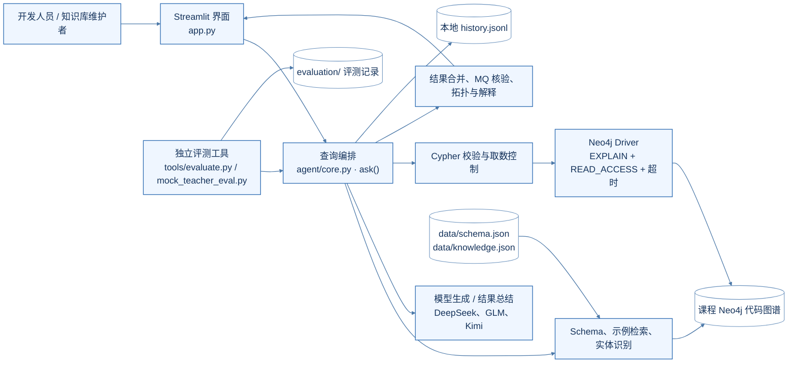
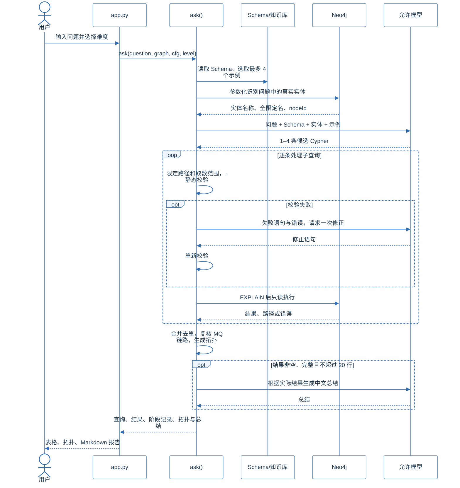

# 面向代码图谱的 Text2Cypher 查询智能体：总体架构

我们把系统定位为一个面向开发人员的代码图谱查询工作台。使用者用自然语言询问接口、方法调用、服务依赖或消息链路，系统负责把问题转换为可核查的 Cypher，并把图谱中的证据连同中文解释交还给使用者。这里的设计重点有两个：查询必须以课程图谱的真实结构为依据；模型生成的语句必须经过校验，才能进入只读执行层。

当前版本已覆盖简单、中等、复杂三档查询，以及单题提问、批量上传、知识库维护、历史查看、拓扑展示和 Markdown 导出。真实 DeepSeek 在用户编写的 30 道模拟教师题上取得 30/30（简单 10、中等 12、复杂 8）；逐题记录见 `evaluation/mock_teacher_2026-10-14/deepseek_baseline_report.md`。这份成绩来自模型独立生成 Cypher，与本地替身的 30/30 分开保存。教师正式题尚未提供。

## 系统全貌

系统在本机以 Python 和 Streamlit 运行。浏览器负责输入与展示，`app.py` 调用 `agent/core.py` 中的 `ask()` 完成查询编排。`agent/core.py` 目前集中了检索、生成、校验、执行和后处理函数；图中的方框表示职责分工，而不是已经拆分出的服务。对外只有两项运行依赖：课程 Neo4j 图谱和所选模型 API。项目没有后台任务队列，批量查询按题顺序执行。

Schema 由 `tools/probe.py` 从真实图谱探查后保存为 `data/schema.json`，运行时直接读取这份快照；实体识别仍会到图谱中核对真实名称、全限定名和 `nodeId`。知识库保存在 `data/knowledge.json`，初始 30 组示例的执行验证在 `data/knowledge_validation.json`。我们把题目与参考答案留在 `evaluation/`，查询时的示例检索只读取知识库，避免评测答案进入模型上下文。

## 一次查询怎样走完

`ask()` 返回一份贯穿全流程的记录，主要字段是 `queries`、`results`、`stages`、`topology`、`summary`、`error` 和 `answer_complete`。界面展示与评测程序都使用这份记录。阶段信息记录检索理由、模型原始输出、校验结果、执行行数和异常，使问题可以回溯到具体步骤。单题页显示当前状态；批量页接收 TXT、带 `question` 列的 CSV 或字符串数组 JSON，最多顺序处理前 100 题并更新进度。

## 模块职责与文件边界

| 职责 | 当前实现 | 输入与产出 |
| --- | --- | --- |
| 界面与导出 | `app.py` 的 `run_one()`、`show()` 和四个页签 | 问题或上传文件；页面结果、批量 JSON、Graphviz 拓扑和 Markdown |
| 图谱连接 | `configuration()`、`Graph.run()` | 本地配置与 Cypher；经过 `EXPLAIN` 的字典行、节点、关系和路径 |
| 查询知识 | `schema()`、`retrieve_ranked()`、`recognize()` | 问题；Schema、最多四个示例及排序理由、真实实体身份 |
| 模型调用 | `generate()`、`parse_queries()` | 问题上下文；1–4 条候选 Cypher，必要时生成中文总结 |
| 校验与限流 | `validate()`、`clamp_generated_limit()`、`clamp_generated_paths()`、`bounded_query()` | 候选 Cypher；可执行的受控查询或明确错误 |
| 结果处理 | `filter_routed_messages()`、`verify_complete_chains()`、`topology()`、`result_summary()` | 图谱返回行；已核实的消息链、拓扑和摘要 |
| 独立评测 | `tools/evaluate.py`、`tools/mock_teacher_eval.py` 及审计脚本 | 独立题目和模型运行；逐题查询、结果与判定记录 |

运行环境和依赖以 `requirements.txt` 为准，其中固定了 Streamlit、Neo4j Python Driver、python-dotenv、pytest 和 PyMuPDF 版本。配置从本机 `.env` 或环境变量读取；模型提供方仅接受 DeepSeek、GLM 或 Kimi。知识库增删改写入本地 `data/knowledge.json`；提问历史追加到被 Git 忽略的 `data/history.jsonl`。这些操作都不修改共享 Neo4j 图谱。

## 查询正确性与只读控制

我们把模型输出当作待检查的候选查询。`validate()` 先遮蔽引号中的字符串，再检查空语句、多语句、注释、写操作、数据库过程、缺失的 `RETURN`，以及 Schema 中不存在的标签、关系和属性。生成语句的路径长度与 `LIMIT` 也有上限；校验失败时只允许模型修正一次，修正后的语句仍按同一规则检查。执行层先运行 `EXPLAIN`，再通过 Neo4j Driver 的 `READ_ACCESS` 会话和超时设置取数。应用与驱动都限制写入；数据库账号是否另有写权限，仍应由图谱管理方核实。

开放式列举问题最多保留 500 行，并额外探测第 501 行。若发现截断，记录会将 `answer_complete` 设为 `false`，摘要也会说明范围限制。页面表格最多显示前 100 行，导出的报告保留已经取得的全部结果。多条子查询先按完整结果行去重；不同投影的中间行可能同时保留，模拟题 H03 多出 1 行入口信息、H08 多出 5 行服务汇总就是目前的展示问题。

MQ 查询另有一层语义校验：共享默认交换机不能单独证明消息送达。只有发布边与交换机到队列的路由边具有相同且非空的路由键，才把消息视为实际到达该队列；完整链路还必须找到队列到消费方法的关系。如果模型只返回方法或路由键等标量，后处理会对可定位的实体再次执行参数化图谱查询，证据不足时标记答案不完整。拓扑也遵守同一原则，只画 Neo4j 实际返回的关系或路径，不根据同一行里的两个节点推测连线。

## 运行维护与验证口径

安装与启动步骤见 `README.md` 和 `docs/项目交接手册.md`。维护图谱时，先用 `tools/probe.py` 更新 Schema，再逐条核查知识库与评测参考；`tools/build_knowledge.py`、`tools/build_evaluation.py` 会改写文件，运行前要备份。当前快照包含 12 种节点标签、13 种关系类型和 19 类有数据的有向模式，课程 PDF 的简化示意不能替代实际探查。

不依赖外部服务的基础检查是 `python -m pytest tests -q`；图谱冒烟需要 Neo4j，真实模型评测还需要个人密钥和独立结果文件。模拟题运行前后的图谱版本/节点数指纹一致，但该指纹不能证明所有属性未变；事后重跑 30 条参考查询的补充复核未完成。现有结果足以说明本地演示和模拟题表现，尚不能代表教师正式题或并发生产负载。下一步扩展应优先处理 H03/H08 的混合结果展示，并持续保持题集与知识库隔离、生成语句先校验、旧评测记录另存这三项约束。
